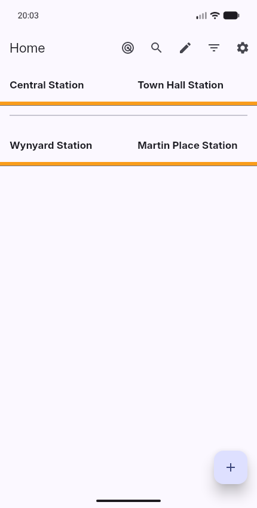
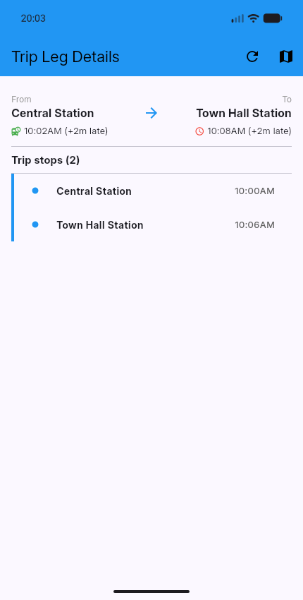
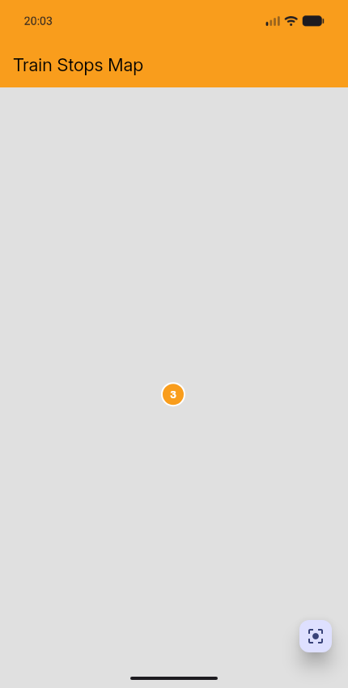

# Flutter Timetable

An Australian public transport app for planning journeys, checking departures,
and keeping your regular trips in one place. Built with Flutter, it brings
saved journeys, timetables, and live service information together in a single app.

[Download for Android](https://github.com/LachlanBWWright/Flutter_Timetable/releases)
· [Report a bug or suggest a feature](https://github.com/LachlanBWWright/Flutter_Timetable/issues)

## What you can do

- **Keep your regular journeys handy.** Save trips, pin favourites, and search
  your saved journeys.
- **Plan a trip.** Search for stops and journey options, or build a journey
  manually with the stops and interchanges you want.
- **Check departures and service details.** View timetables, stopping patterns,
  and live updates where available.
- **Explore the network.** Find stops on a map and see vehicle positions when
  a live feed is available.
- **Make it your own.** Set a home stop and choose your display preferences.

## A look inside

  
  
  

## Coverage

New South Wales is enabled in the default app. The project also includes
integrations for Victoria, Queensland, South Australia, Tasmania, the Northern
Territory, and Western Australia. Regional availability varies between builds;
not every region or provider offers the same journey planning and live data.

Timetables and live information come from transport providers. Live updates
may be delayed or unavailable, and saved or cached information may be older
than the latest service changes.

## Get the app

Download an Android APK from [GitHub Releases](https://github.com/LachlanBWWright/Flutter_Timetable/releases)
and open it on your phone to install. Android may ask you to allow installation
from your browser or file manager.

For authenticated NSW services, add your TfNSW API key in the app's Settings.
Published builds do not include a provider key by default.

## Contributing

Bug reports, feature ideas, and contributions are welcome. When reporting a
problem, include the app version, your device, the transport region, and what
you expected to happen.

Want to run the app or contribute code? Start with the
[development guide](docs/DEVELOPMENT.md).
